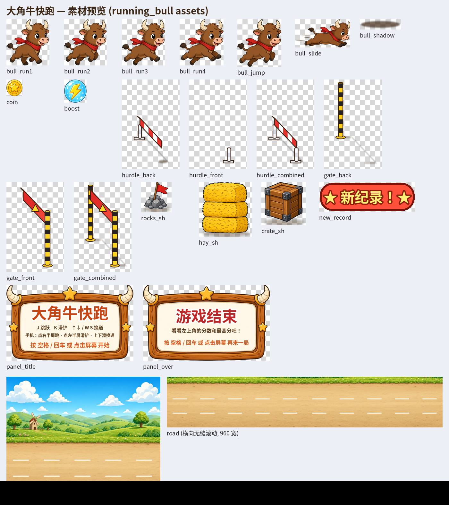

# 大角牛快跑（running_bull）

一个基于 [XBuilder](https://github.com/goplus/builder)（spx 游戏引擎 + XGo 语言）的「天天酷跑 / 地铁跑酷」风格无尽跑酷小游戏。主角是可爱的**大角牛**，在三条跑道上自动向前奔跑：跳过低栏、滑铲钻过高栏、换道躲开草垛和木箱，一路收集金币，吃到闪电还能冲刺！

竖屏手机网页在 `running_bull_web/public/mobile-web/`。本地先 `cd running_bull_web && python3 server.py`，再打开 <http://127.0.0.1:3000/mobile-web/> ；线上是 <https://bull.lingecho.com/mobile-web/> （nginx 直接提供 `public/` 里的静态文件，横版仍在网站根路径）。口号「勇敢牛牛，不怕困难」。打开页面会用本机设备号自动登录，竖屏成绩记在这个账号上。说明见 `running_bull_web/README.md` 的「四.1」「四.2」。



## v5.1 修复：XBuilder 网页里登录 / 注册后画面变白

- **原因（已在浏览器里复现确认）**：XBuilder 网页版里游戏跑在 WebAssembly 上，`net/http` 要等浏览器 fetch 完成。v5 在脚本里直接同步等待请求，引擎每帧的更新（从浏览器回调进 Go）要等脚本让出，脚本又在等 fetch，fetch 又要等这次回调结束才能回来 → Go 运行时报 `fatal error: all goroutines are asleep - deadlock!`，wasm 退出（exit code 2），画面变白。本地 `spx run` 是原生运行，不会出现。
- **修复**：所有请求都放到后台 goroutine 里发（带 recover，出错不会让游戏崩），脚本每帧 `waitNextFrame` 用非阻塞的 select 检查结果，不再阻塞引擎；等待期间不接受重复的登录 / 购买 / 开局操作。游客模式完全不联网。
- **调试日志**：浏览器控制台里每个网络步骤都会打印 `[bull]` 开头的一行（请求开始、响应状态、JSON 解析结果、网络错误、被拦截的 panic、请求结束），出问题时看这些行就知道卡在哪一步。

## v5 新增（联网账号：钱包 / 解锁 / 最高分存到线上服务器）

- **一打开先是登录面板**：
  - 昵称：点 ◀ ▶（或键盘 ← →）在几个预设昵称里选，或点「自己输入 [T]」（按 T）弹出输入框自己打（spx 的 `ask` 输入框）。
  - PIN：4 位数字，点面板右边的数字键盘，或直接按键盘数字键；「删除」/ Backspace 删一位，「清空」全删。
  - 「登录 [回车]」/「注册新账号 [R]」/「游客试玩（不存档）[G 或 Esc]」。
  - 标题页 / 结算页点「账号 L」按钮（或按 L）可以换号或改成游客。
- **登录后**：钱包、已解锁的角色和地图、当前装备、护盾 / 双倍库存、最高分都从服务器读；商店购买、开局（自动用道具）、金币复活 / 示意广告复活、结算都走服务器，**服务器说了算**（按真实时长封顶防作弊，双倍金币由服务器计算）。结算后左上角显示「在线 · 昵称 · 全服第 N 名」。换台电脑 / 刷新网页，用同一昵称 + PIN 登录，数据都在。
- **游客试玩**：和 v4 一样，数据只在本次打开期间有效。
- **网络出错**：一次失败会提示「网络不稳，请再试一次」（这次没扣钱也没买）；连续两次失败就自动转为**离线**（左上角显示「离线（…）」并弹提示），之后按游客规则继续玩，当前钱包等数据留在本次会话里。登录时连不上服务器会提示「连不上服务器，可以先选游客试玩」。
- **价格和服务器统一**：粉粉猪 300、咩咩羊 600、黄沙大漠 200、星星夜晚 500、无敌护盾 60、双倍金币 80、金币复活 100（联网时以服务器下发的价格为准）。
- 后台地址只有一个常量：`main.spx` 顶部的 `const apiBase = "https://bull.lingecho.com/api"`。后台代码在 `running_bull_web`（同一套后台也服务网页版），新增接口见它的 README「7.1 / 7.2」。

## v4 新增（多角色 / 多地图 / 金币商店 / 复活）

- **3 个角色**：大角牛（默认）、粉粉猪（120 金币）、咩咩羊（200 金币），各有跑步 4 帧 + 跳跃 + 滑铲造型（新角色用 Pillow 绘制）。
- **3 张地图**：青青草原（默认）、黄沙大漠（100 金币）、星星夜晚（150 金币，带月亮和星星，障碍也会变暗）。
- **金币商店**：标题页和结算页按 **B** 或点右下角「商店」打开。
  - 键盘：←→↑↓（或 W A S D）移动选择框，**J / 空格 / 回车** 购买或使用，**B / Esc** 返回。
  - 鼠标 / 手指：直接点卡片购买或使用，点右上角「返回」回到标题页。
  - 道具：**无敌护盾**（40 金币，下一局开局自动带上，挡一次撞车）、**双倍金币**（60 金币，下一局金币 ×2，飘字变成「+20」），每样最多持有 3 个，每局用 1 个。
  - **钱包**：每局结束把本局金币存进钱包（右上角「钱包」），跨局累计。⚠️ spx v3.3.0 没有本地存储接口，钱包、已买的角色 / 地图 / 道具都只在本次打开游戏期间有效，**刷新网页或重新运行就清零**。
- **复活**：每局第一次撞车时游戏暂停，弹出复活面板：
  - **[1] 花 80 金币复活**（钱包不够时按钮变灰）；
  - **[2] 看示意广告复活**：3 秒倒计时，面板上标着「示意广告」，演示用，不是真实广告；
  - **[3] / Esc 放弃** → 结算。也可以直接点面板上的按钮。
  - 复活后无敌 2 秒（角色一闪一闪），附近的障碍会被清掉；**第二次撞车直接结束**。护盾会先于复活生效。

## v3 新增（打击感 + 音效 + 手感）

- **打击感**：吃金币飘出金色「+10」；撞车时全屏白闪 + 火花四溅；落地时脚下扬起两团烟尘；冲刺时画面（路面、大角牛、影子）轻微抖动。
- **音效 + 背景音乐**：用 Python 自己合成的原创音效（跳、滑铲、金币、冲刺、撞车、新纪录）和一段可无缝循环的欢快 BGM（132 BPM，约 7 秒一循环）。开始游戏时 BGM 开始循环，撞车时停止。
- **操作容错**：跳跃缓冲——落地前约 0.15 秒内按的「跳」会被记住，落地瞬间自动起跳，连续跳更顺手。
- **手机按钮**：游戏中右下角「跳」、左下角「滑」两个圆按钮，**按下瞬间就生效**（不用等松手），按下时会变亮缩一下。原来的点左 / 右半屏、上下滑换道照样能用，按钮不会和半屏点击重复触发。键盘操作不变。

## 一、导入到 XBuilder

1. 打开 XBuilder：国内推荐 <https://x.qiniu.com>，海外可用 <https://xbuilder.com>，并登录。
2. 新建或打开任意项目，在编辑器顶部的 **项目（Project）菜单** 中选择 **导入项目文件（Import project file）**。
3. 选择本文件夹里的 `running_bull.xbp`，确认导入（会替换当前项目内容，建议先新建一个空项目再导入）。
4. 点击 **运行（Run）** 开始游戏。

`.xbp` 文件本质是一个 zip 包，里面就是 `project/` 文件夹的内容，再加上 `builder-meta.json`（项目显示名「大角牛快跑」、简介、玩法说明）和 `builder-thumbnail.jpg`（封面图）。

## 二、操作说明

| 动作 | 键盘 | 手机 / 触屏 |
| --- | --- | --- |
| 开始 / 重新开始 | 空格、回车、J，或点击画面 | 点一下屏幕（任意位置） |
| 跳跃（跳过低栏、石堆） | **J**（游戏中空格也能跳） | 右下角「**跳**」按钮，或点**右半屏** |
| 滑铲（钻过高栏） | **K**（空中按下会快速落地） | 左下角「**滑**」按钮，或点**左半屏** |
| 换到上面（远处）的跑道 | **↑ / W** | 向上滑 |
| 换到下面（近处）的跑道 | **↓ / S** | 向下滑 |
| 打开 / 关闭商店（标题页、结算页） | **B**（关闭也可按 Esc） | 点右下角「商店」/ 商店右上角「返回」 |
| 商店里选择 / 购买 | ←→↑↓ / WASD 选择，J / 空格 / 回车 购买或使用 | 点卡片 |
| 撞车后复活选择 | **1** 花金币 · **2** 看示意广告 · **3 / Esc** 放弃 | 点面板上的按钮 |

> 在空中提前按跳（落地前约 0.15 秒内）会在落地时自动再跳。
> 画面是横版侧视角，三条跑道从上到下排列：上面远、下面近。左右滑动不做任何操作。

## 三、玩法

- **三种路障**，每种需要不同的躲法：
  - 低栏（红白横杆）/ 石堆：**跳**过去；
  - 高栏（黄黑立柱 + 高高的红色横梁）：**滑铲**从横梁下面钻过去（跳起来会撞上）；
  - 草垛 / 木箱：太高太宽，只能**换道**绕开。
- 低栏和高栏是**有纵深的立体栏杆**：横杆斜跨整条跑道（远端的腿在上、近端的腿在下），地上有影子。每个栏杆拆成“后层”（远侧的腿 / 立柱、横杆、影子）和“前层”（近侧的腿 / 立柱，高栏的横梁也在前层）两个克隆，大角牛夹在两层中间画，所以能看出它是从栏上跳过去、从横梁下钻过去的。
- 大角牛脚下有影子，始终贴在所在跑道的地面上，跳得越高影子越小，一眼就能看出它在哪条跑道、离地多高。
- **金币**：同一跑道碰到就收集，每枚 +10 分。
- **闪电（加速道具）**：冲刺约 5 秒——速度 ×1.6、**无敌**（撞飞路障还加分）、**磁铁**（附近金币自动飞过来）。右上角显示「冲刺」剩余秒数。
- **越跑越快**：速度随时间增加，障碍越来越密，后期还会同时出现两个障碍（保证总有一条路能过）。
- **计分**：分数 = 跑过的距离 + 金币 × 10。
- **最高分**：左上角一直显示「最高分」；游戏结束时如果刷新纪录，会弹出「★ 新纪录！★」。

> ⚠️ 最高分只在**本次打开游戏期间**保留（重开很多局都在，但刷新网页或重新运行项目后会清零）。我查过 spx 引擎源码，目前没有可用的本地存储 / 存档 API，所以没法跨会话保存。

## 四、文件说明

```
running_bull/
├── README.md              本说明
├── running_bull.xbp       可直接导入 XBuilder 的项目文件
├── preview.png            全部美术素材预览图
├── thumbnail.jpg          项目封面（用素材合成的示意图，不是运行截图）
├── screenshot_*.png       本地 spx 引擎实际运行截图：标题、跳过低栏（jump_hurdle）、滑铲钻高栏（slide_gate）、后期游戏画面（play）
├── screenshot_v4_*.png    v4 截图：商店、三张地图 × 三个角色、复活面板 / 示意广告 / 复活后无敌、护盾抵挡、结算
├── screenshot_v3_*.png    v3 新效果截图：+10 飘字、落地扬尘、撞车白闪 / 火花、冲刺、屏幕按钮
├── tools/                 素材处理与打包脚本（Python/Pillow）和 AI 生成的原图
└── project/               项目源码（标准 spx 目录结构）
    ├── main.spx           舞台代码：游戏状态、计分、最高分、难度、生成障碍、键盘控制、触屏点击 / 滑动检测
    ├── Bull.spx           大角牛：跑步动画、跳跃物理、滑铲、平滑换道（近大远小）、冲刺发光
    ├── Obstacle.spx       路障克隆体：移动、前后图层（纵深）、按种类判定碰撞、冲刺时撞飞
    ├── Shadow.spx         大角牛脚下的影子
    ├── Coin.spx           金币克隆体：收集、冲刺磁铁效果
    ├── Boost.spx          闪电加速道具
    ├── Road.spx           两张无缝路面循环滚动
    ├── Panel.spx          标题面板「大角牛快跑」/「游戏结束」面板
    ├── NewRecord.spx      「新纪录！」徽章（弹出时播放新纪录音效）
    ├── Fx.spx             特效克隆：+10 飘字、火花、扬尘（v3）
    ├── Flash.spx          撞车全屏白闪（v3）
    ├── BtnJump.spx / BtnSlide.spx  手机屏幕按钮「跳」「滑」（v3）
    ├── Shop.spx / ShopCard.spx / ShopCursor.spx / ShopClose.spx / ShopBtn.spx  金币商店（v4）
    ├── Revive.spx         复活面板 / 示意广告倒计时（v4）
    ├── Toast.spx          提示条：金币不够、购买成功、护盾抵挡、复活……（v4）
    └── assets/
        ├── index.json     舞台配置：背景、角色层级、分数 / 金币 / 最高分 / 冲刺 显示框
        ├── backdrop.png   农场背景（蓝天、草地、风车）
        ├── sprites/<角色名>/index.json + 造型 PNG
        └── sounds/<声音名>/index.json + WAV：bgm、jump、slide、coin、boost、crash、newrecord（v3，原创合成）
```

角色造型：

- `Bull`：bull_ / pig_ / sheep_ 各 6 个造型：run1–run4（跑步 4 帧）、jump、slide（按 角色×6 + 动作 的序号切换）
- `Road`：road / road_desert / road_night；舞台背景：farm / desert / night
- `Obstacle`：hurdle_back / hurdle_front（低栏后层 / 前层）、rocks（石堆）、gate_back / gate_front（高栏后层 / 前层）、hay（草垛）、crate（木箱）
- `Shadow`：大角牛的影子
- `Coin`、`Boost`、`Road`、`Panel`（title / over）、`NewRecord`
- `Fx`：plus10 / spark / dust；`Flash`：white；`BtnJump` / `BtnSlide`：btn

所有图片都是 2 倍分辨率 PNG（`bitmapResolution: 2`），透明背景，舞台大小 480×360。

## 五、想改一改？

都在 `main.spx` 开头附近：

- 初始速度 `speed = 4.5`、最高速度 `11`、加速快慢 `frames*0.0025`
- 障碍间距 `rand(230.0, 360.0)`，最小间距 `170`
- 冲刺时长 `boostTime = 300`（帧，约 5 秒）
- 跑道位置 `laneY()`、近大远小 `laneScale()`

## 六、测试情况

- 代码用 XGo 编译器（xgo v1.7.5）+ spx v3.3.0（XBuilder 当前用的引擎版本）编译通过（`xgo go` + `go vet` + `go build`）。
- 在本地用 spx 引擎的**解释运行模式**（`spx run`，和 XBuilder 网页里一样是解释执行）实际跑过：标题、开始、跳跃、滑铲、换道、金币、冲刺、撞车结束、新纪录、重新开始都正常；J / K / ↑↓ / W S / 空格 / 回车、鼠标点左 / 右半屏、上下拖动滑动都测过。还用一个自动驾驶测试版连续跑到 7000+ 分没撞车，验证三种躲法都能过、克隆体能正常回收；并在跳过低栏、钻过高栏的瞬间暂停截图，确认前后图层正确（见 screenshot_jump_hurdle*.png、screenshot_slide_gate*.png）。
- v3：重新编译通过；`spx run` 实测——+10 飘字、落地扬尘、撞车白闪 + 火花、冲刺抖动、两个屏幕按钮都截图确认（screenshot_v3_*.png）；日志确认按「跳」「滑」按钮各只触发一次、松手不会重复触发，点左 / 右半屏仍然有效，跳跃缓冲生效（空中提前按跳，落地自动起跳）；7 个声音资源加载无报错。**声音本身没有听过**（测试机没有声卡，引擎用的是静音驱动）。
- v4：重新编译通过；`spx run` 自动测试走通了：看示意广告复活、花金币复活（钱包 730 → 650）、复活后第二次撞车直接结算、放弃复活、护盾挡一次撞车、双倍金币（本局金币 40）、钱包跨局累计、键盘购买（钱不够时提示「金币不够」）、鼠标点卡片购买 / 切换角色和地图、商店「返回」按钮。测试版额外加了调试键 M（+1000 金币）和自动驾驶 P，**正式版里没有**。
- v5：重新编译通过；`spx run` 对本地后台实测：注册（新号 100 金币）、买护盾（100 → 40）、买粉粉猪金币不够（402 → 提示「金币不够」）、开局自动用护盾、护盾挡一次、示意广告复活（服务器校验看满 3 秒）、结算（服务器发金币、记最高分、返回排名）、**关掉游戏重新运行再登录，钱包 / 最高分 / 已买角色都还在**、金币复活（服务器扣 100）、运行中把后台关掉 → 第一次提示「网络不稳」、第二次转离线并按离线规则继续玩、后台没开时登录提示「连不上服务器」再选游客试玩。又用测试账号对**线上 https://bull.lingecho.com/api** 跑了一遍注册 / 购买 / 开局 / 广告复活 / 结算 / 重新登录（数据保留），测试账号已删除。还在无头 Chrome 里从 https://xbuilder.com 和 https://x.qiniu.com 页面直接 fetch 线上接口，跨域（CORS）通过。截图见 screenshot_v5_*.png。
- **还没在 XBuilder 网页里实际导入过**（需要登录账号），也没在真机手机上试过触屏。

## 七、已知限制

- 游客模式下最高分、钱包、已买的东西仍然不能跨会话保存（spx v3.3.0 没有本地存储接口）；登录账号后存在服务器上。
- 联网请求是“同步”的：请求期间游戏画面会停一下（正常不到 1 秒，最多等 4 秒超时）。
- 本地运行时，数值框（monitor）里的中文显示成方框，这是本地 spx 运行时缺中文字体，XBuilder 网页里应该正常（v4 的「钱包」也是这样）。
- 在 XBuilder 网页里真正发出请求（spx 的 wasm 版 net/http → 浏览器 fetch）还没有端到端试过；已确认的是线上接口对 xbuilder.com / x.qiniu.com 的跨域放行，以及游戏不使用自定义请求头（令牌放在请求体里），所以只需要服务器放行 Content-Type。
- 从测试机访问 bull.lingecho.com 时大约 1/10 的 HTTPS 握手会失败（服务器在国内，可能和域名备案 / 线路有关），游戏里登录类请求会自动重试一次，其余请求失败会提示再试。
- 「示意广告」只是 3 秒倒计时，没有接任何真实广告 SDK。
- 音效是程序合成的 8-bit 风格，比较简单；浏览器要求用户先操作一下才能放声音，所以 BGM 在按键 / 点击开始后才响。
- 侧视角下，跑道之间的前后遮挡是用代码实时调整图层实现的，偶尔切道瞬间可能有一帧遮挡不自然。
- 跳跃最高约 67 像素，比跑道间距（50 像素）高，所以跳到最高点时牛看上去像到了上一条跑道——看脚下的影子就知道它其实还在原来的跑道。
- 触屏：游戏中点右半屏跳、点左半屏滑铲、上下滑换道（松手时才算“点一下”，所以有一点点延迟；v3 的「跳」「滑」按钮是按下就生效，没有这个延迟）。触屏是用 `mousePressed` / `mouseX` / `mouseY` 自己判断的（本地实测 spx 自带的 `onSwipe` 上下方向是反的，所以没用它）；手机浏览器一般会把触摸当成鼠标，但没在真机上验证。
- 本地运行时（没有中文字体）左上角分数标签和气泡里的中文显示成方块；XBuilder 导入时会自动给项目加上中文字体，正常情况下能正常显示。
